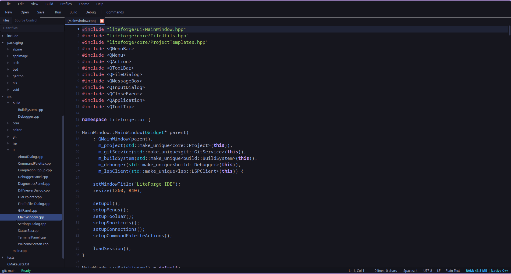

# LiteForge IDE

<p align="center"></p>

<p align="center"><strong>A small, fast, customisable code editor and IDE in C++20 and Qt 6.</strong></p>

<p align="center">
  <a href="https://github.com/Dacraezy1/LiteForge-IDE/actions"></a>
  <a href="https://github.com/Dacraezy1/LiteForge-IDE/releases"></a>
  <a href="LICENSE"></a>
</p>



## Why

No Electron, no JavaScript runtime, no telemetry, no plugin host. One native binary (about 0.9 MB stripped) that links Qt 6 Widgets and nothing else.

Memory and startup are kept low by design, not by magic:

- Terminal, Source Control, Debugger, Settings, Command Palette, Find in Files and the rest are **built on first use**. No shell is spawned until you open the terminal or build.
- Syntax highlighting uses grouped patterns shared between all open files.
- Huge files open without highlighting or minimap; extremely large files are refused instead of freezing the UI.
- Saved tabs are restored after the window is already on screen.

Measured with the offscreen Qt platform on one machine (Qt 6.4, GCC 13), 1.1.0 vs 1.2.0:

| | 1.1.0 | 1.2.0 |
|---|---|---|
| Empty launch, RSS | 47.3 MB | 37.8 MB |
| Empty launch, private (anonymous) memory | 14.0 MB | 9.2 MB |
| 6 C++ files restored, RSS | 56.2 MB | 43.3 MB |
| Startup CPU time, empty / 6 files | 90 / 300 ms | 30 / ~100 ms |

Most of the remaining RSS is Qt's own shared libraries, which are mapped by every Qt application. Your numbers will differ; measure on your system.

## Features

- **Editor**: multi-cursor, code folding, minimap, sticky scroll, bracket matching and auto-close, word wrap, split panes, preview tabs, pinned tabs, find/replace with regex, find in files, go to line.
- **Languages**: C/C++, Python, Rust, JavaScript/TypeScript, JSON, Markdown, CMake, Shell/Makefile highlighting.
- **LSP client**: completion, hover, go to definition, references, rename, formatting, diagnostics (configure the server per profile, e.g. `clangd`).
- **Git**: status, diff, stage, commit, pull, push, branch in the status bar.
- **Build / run / debug**: CMake, Make, Cargo, single-file C/C++/Python, custom commands; GDB/MI debugger with breakpoints in the gutter.
- **Integrated terminal**, problems panel with click-to-jump.
- **Safe saving**: atomic writes, CRLF and UTF-8 BOM preserved, optional trim-trailing-whitespace and final newline, auto-save, reload when a file changes on disk.
- **Command palette** (Ctrl+Shift+P) generated from the menus, fuzzy **Quick Open** (Ctrl+P).
- **Workspace profiles** (language server, build command, theme per language).

## Customise everything with plain files

All files live in the config directory (`~/.config/LiteForge/LiteForge/` on Linux). Open them from the **Help** menu; saving one applies it immediately.

### Settings: `config.json`
```json
{
  "editor": { "fontFamily": "JetBrains Mono", "fontSize": 12, "tabWidth": 4,
              "minimap": false, "stickyScroll": true, "largeFileKiB": 2048,
              "autoSaveDelayMs": 3000, "autoSaveOnFocusLoss": true },
  "ui":     { "density": "compact", "fontSize": 10, "cornerRadius": 2,
              "accent": "#ff8800", "showToolbar": false, "showStatusBar": true },
  "general":{ "restoreSession": true, "lspEnabled": true }
}
```
Missing keys use defaults; out-of-range values are clamped; a broken file never stops the app from starting.

### Themes: `themes/*.json`
Start from **Help -> Export Current Theme as Template**, or write only what you want to change:
```json
{ "name": "My Theme", "base": "Nord",
  "colors": { "accent": "#ff8800", "keyword": "#ff5555", "editorBg": "#101216" } }
```
Valid color keys are the 40 fields in the exported template. Built-ins: LiteForge Obsidian, One Dark Pro, Tokyo Night, Monokai Pro, Cyberpunk Neon, LiteForge Daylight, Gruvbox Dark, Nord, Catppuccin Mocha. An example is installed to `share/doc/liteforge/example-themes/`.

### Keybindings: `keybindings.json`
**Help -> Open Keybindings (JSON)** creates the file with every action and its current shortcut. Edit a value to rebind it, or set `""` to unbind:
```json
{ "File/Save": "Ctrl+S", "Edit/Toggle Comment": "Ctrl+;", "View/Toggle Minimap": "Ctrl+M" }
```

## Install

Download from the [Releases](https://github.com/Dacraezy1/LiteForge-IDE/releases) page and verify with `SHA256SUMS.txt`.

| Format | Command |
|---|---|
| AppImage (x86_64, aarch64, armv7; needs glibc 2.39+) | `chmod +x LiteForge-*.AppImage && ./LiteForge-*.AppImage` |
| Debian / Ubuntu / Mint | `sudo apt install ./liteforge_1.2.0_amd64.deb` |
| Fedora / RHEL / openSUSE | `sudo dnf install ./liteforge-1.2.0-1.*.x86_64.rpm` |
| Portable tarball | `tar xzf liteforge-1.2.0-linux-x86_64.tar.gz && ./liteforge-1.2.0-Linux/bin/liteforge` |

Distro recipes are in [`packaging/`](packaging/): Arch (`arch/PKGBUILD`, `PKGBUILD-git`), Alpine (`alpine/APKBUILD`), Gentoo (`gentoo/*.ebuild`), Nix (`nix/flake.nix`, `default.nix`, `package.nix`), Void (`void/template`), RPM (`rpm/liteforge.spec`), FreeBSD / OpenBSD / NetBSD ports (`freebsd/`, `openbsd/`, `pkgsrc/`) and a generic `bsd/build-bsd.sh`.

Checksums inside recipes are placeholders (`SKIP` / zeros / `fakeHash`) until the release tag exists; each file says which command regenerates them (`updpkgsums`, `abuild checksum`, `xgensum`, `make makesum`, `nix-prefetch-github`).

## Build from source

Requirements: CMake 3.20+, a C++20 compiler (GCC 11+/Clang 14+), Qt 6.2+ (Core, Gui, Widgets).

```sh
cmake -B build -DCMAKE_BUILD_TYPE=Release
cmake --build build --parallel
QT_QPA_PLATFORM=offscreen ctest --test-dir build --output-on-failure   # headless tests
./build/liteforge
sudo cmake --install build
```

Options: `-DENABLE_TESTING=OFF`, `-DLITEFORGE_LTO=OFF`. Packages: `cd build && cpack -G TGZ` (or `DEB`, `RPM`).

## Releasing

1. Bump `VERSION` in `CMakeLists.txt` (single source of truth) and the recipes in `packaging/`.
2. `git tag v1.2.0 && git push origin v1.2.0`. The *Release* workflow refuses a tag that doesn't match `CMakeLists.txt`, builds every package and publishes them with `RELEASE_NOTES.md`.

## License

GPLv3, see [LICENSE](LICENSE).
